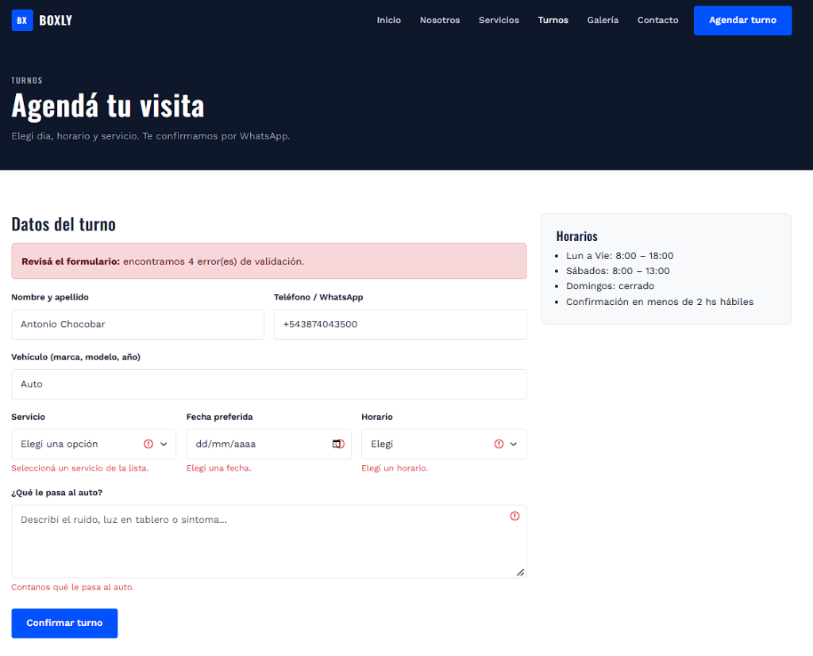
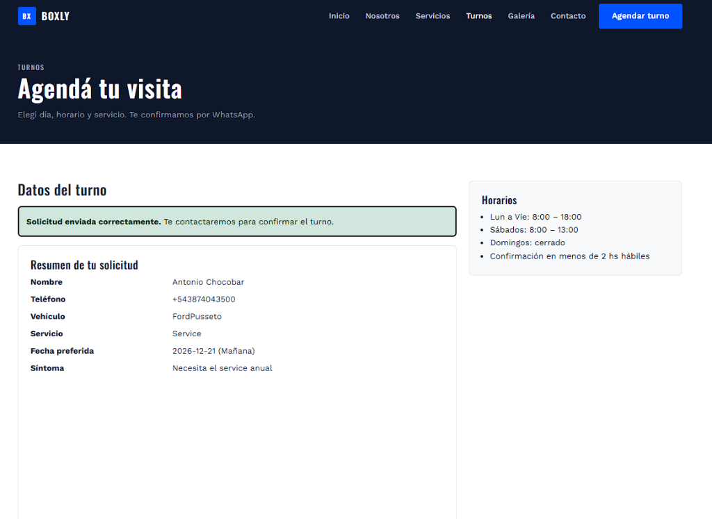
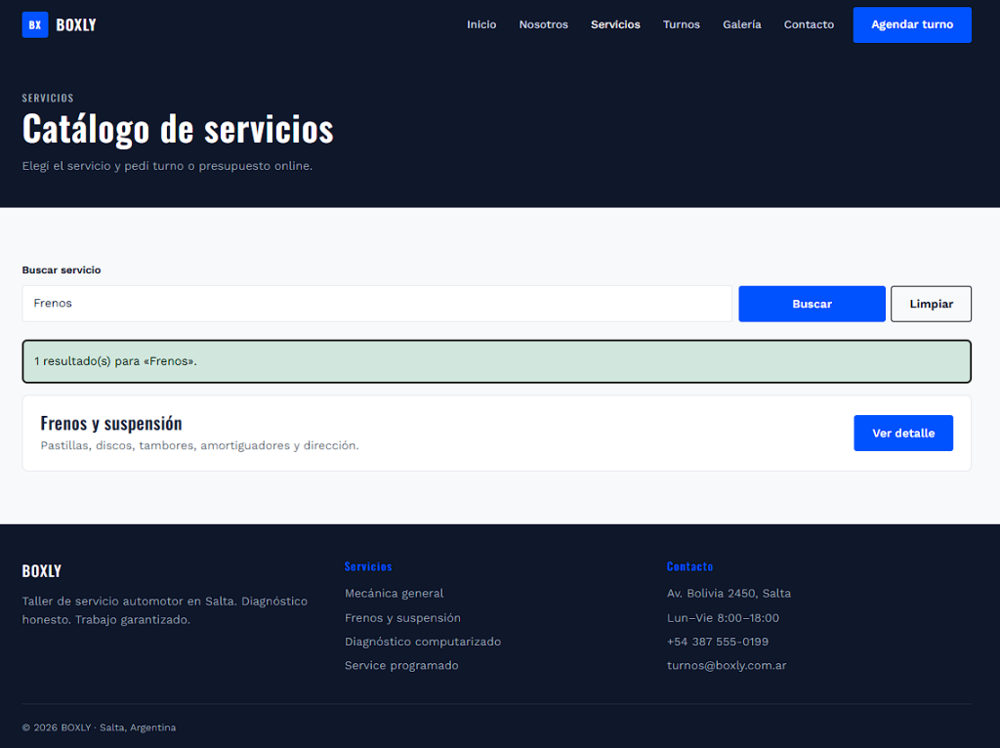
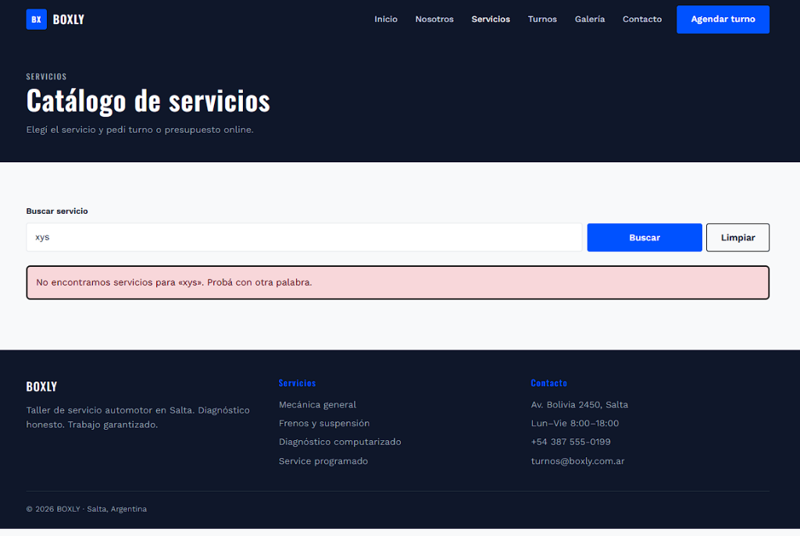
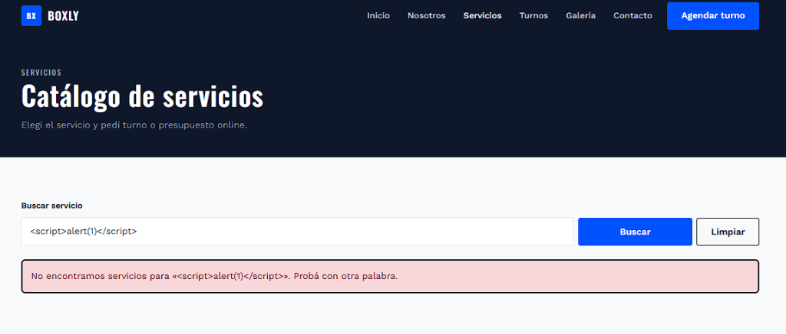

# BOXLY — Programación Web

Sitio del taller **BOXLY** (Salta): servicio mecánico automotor. Maquetación HTML5 + Bootstrap 5,
backend en PHP y persistencia en MySQL mediante PDO.

## Enlaces

- **Repositorio:** https://github.com/Antony27c/Programacion-Web
- **Mockups Figma:** https://www.figma.com/design/1MKE3Skw1MhIkSsq2L2091/Taller-Mecanico-Mockups-UI-UX-TP3
- **Versión estática (TP4) en GitHub Pages:** https://antony27c.github.io/Programacion-Web/entregas/tp4-html/

## Estructura

```
├── config/
│   ├── conexion.php                 ← TP7: conexión PDO con try-catch
│   ├── conexion.local.example.php   ← plantilla de credenciales
│   └── conexion.local.php           ← credenciales reales (NO se versiona)
├── database/
│   └── boxly.sql                    ← TP7: base `boxly` + tabla `turnos` + datos de ejemplo
├── includes/
│   ├── header.php  footer.php       ← plantilla modular
│   └── funciones.php                ← sanitización, validación de turnos, CSRF
├── admin/                           ← TP7: CRUD de turnos
│   ├── index.php                    ← listado (Read) + filtro por estado
│   ├── crear.php                    ← alta (Create)
│   ├── editar.php                   ← modificación (Update)
│   ├── eliminar.php                 ← baja (Delete)
│   └── _formulario.php              ← formulario compartido alta/edición
├── index.php nosotros.php servicios.php servicio-detalle.php turnos.php
├── presupuesto.php testimonios.php galeria.php contacto.php faq.php
├── css/  js/  img/
├── entregas/
│   └── tp4-html/                    ← TP4: sitio estático HTML + auditoría Lighthouse
└── docs/
    ├── tp3/                         ← wireframe, informe TP3 y mockups Figma
    └── tp5/screenshots/             ← capturas TP5
```

## Tecnología

- HTML5 semántico, Bootstrap 5.3 (CDN), CSS propio (paleta BOXLY)
- PHP 8 con includes modulares
- MySQL 8 + PDO (consultas preparadas)
- Prettier

## Paleta

| Token | Hex | Uso |
|-------|-----|-----|
| Ink | `#0F172A` | Header, footer, hero |
| Texto | `#1E293B` | Tipografía principal |
| Acento | `#0052FF` | CTA, marca, links |
| Titanio | `#6C757D` | Texto secundario |
| Fondo | `#F8F9FA` | Superficies |
| Éxito | `#10B981` | Confirmaciones |

## Cómo correrlo en local

1. **Base de datos:** en MySQL Workbench abrir `database/boxly.sql` (*File → Open SQL Script*) y
   ejecutarlo. Crea la base `boxly` con la tabla `turnos` y 5 registros de ejemplo.
2. **Credenciales:** completar la contraseña de MySQL en `config/conexion.local.php`
   (si no existe, copiar `config/conexion.local.example.php` con ese nombre).
3. **Servidor:**

   ```bash
   # Servidor embebido de PHP (o copiar el proyecto a htdocs de XAMPP)
   php -S localhost:8099
   ```

4. Abrir http://localhost:8099 (sitio) y http://localhost:8099/admin/ (panel de turnos).

---

## TP7 — Persistencia y conexión PHP-MySQL segura

Entidad gestionada: **`turnos`** del taller (cliente, teléfono, vehículo, servicio, fecha,
horario, síntoma y estado). El flujo completo queda integrado al sitio:

- El cliente pide un turno desde **`turnos.php`** → se valida en servidor y se guarda en MySQL.
- El taller lo gestiona desde **`admin/`**: lo lista, filtra por estado, edita (p. ej. pasa de
  *Pendiente* a *Confirmado*) o elimina.

### Seguridad aplicada

| Requisito | Implementación |
|-----------|----------------|
| Conexión segura | `config/conexion.php`: PDO con `ERRMODE_EXCEPTION`, `FETCH_ASSOC`, `EMULATE_PREPARES = false` y `try/catch (PDOException)`. El detalle del error va a `error_log`, no al navegador. Credenciales fuera del repo. |
| SQL Injection | **Todas** las consultas (`SELECT`, `INSERT`, `UPDATE`, `DELETE`) usan `prepare()` + `execute()` con `:parametros`. El `id` se valida con `FILTER_VALIDATE_INT`. |
| XSS | Toda variable impresa pasa por `e()` → `htmlspecialchars(..., ENT_QUOTES, 'UTF-8')`. |
| Validación | `validarTurno()` en servidor: obligatorios, largo, regex de teléfono, fecha válida y listas blancas para servicio, horario y estado (coinciden con los `ENUM` de la tabla). |
| CSRF | Alta, edición y baja exigen un token de sesión (`csrfToken()` / `csrfValido()`). La baja solo acepta `POST`: un link GET no puede borrar registros. |

### Modelo de datos (`database/boxly.sql`)

| Campo | Tipo |
|-------|------|
| `id` | INT UNSIGNED, PK, AUTO_INCREMENT |
| `nombre` | VARCHAR(120) |
| `telefono` | VARCHAR(20) |
| `vehiculo` | VARCHAR(150) |
| `servicio` | ENUM('Service','Frenos','Diagnóstico','Otro') |
| `fecha` | DATE (indexado) |
| `horario` | ENUM('Mañana','Tarde') |
| `sintoma` | TEXT |
| `estado` | ENUM('Pendiente','Confirmado','Finalizado','Cancelado') |
| `creado_en` / `actualizado_en` | TIMESTAMP |

---

## TP5 — Procesamiento de formularios y seguridad web (PHP)

El sitio completo en **PHP** con estructura modular (`includes/header.php`, `includes/footer.php`,
`includes/funciones.php`) y lógica de servidor para capturar y procesar datos del navegador.

### Formulario POST — Solicitud de turno (`turnos.php`)

- Sanitización de `$_POST` con `trim()` + `htmlspecialchars()` (helpers `limpiar()` y `e()`) → previene **XSS**.
- Validación en servidor: obligatorios, teléfono con regex, fecha válida y no pasada, listas
  blancas y **formato de email** con `filter_var(..., FILTER_VALIDATE_EMAIL)` en `contacto.php` y `presupuesto.php`.
- Retroalimentación con `alert-success` / `alert-danger` + `is-invalid` / `invalid-feedback` por campo.
- Persistencia de los valores cargados (escapados) ante errores.

### Formulario GET — Buscador de servicios (`servicios.php?q=`)

Filtra el catálogo en servidor con `filter_input(INPUT_GET, ...)` y `mb_stripos()`; todo resultado
se imprime escapado.

### Capturas

**POST — Errores de validación y persistencia de campos**



**POST — Envío exitoso con resumen de datos procesados**



**GET — Buscador con resultados filtrados** (`servicios.php?q=Frenos`)



**GET — Búsqueda sin coincidencias** (`servicios.php?q=xys`)



**XSS neutralizado** — el `<script>` se imprime como texto, no se ejecuta



---

## TP3 / TP4 — Mockups y maquetación

- Mockups UI/UX en Figma: [`docs/tp3/mockups/`](docs/tp3/mockups/) · wireframe: [`docs/tp3/wireframe-figma-taller.png`](docs/tp3/wireframe-figma-taller.png)
- Maquetación estática de las 10 vistas (HTML + Bootstrap): [`entregas/tp4-html/`](entregas/tp4-html/) · auditoría: [`auditoria-lighthouse.md`](entregas/tp4-html/auditoria-lighthouse.md)

## Alumno

Chocobar Antonio  
Tecnicatura Superior en Análisis de Sistemas y Desarrollo de Software — IES N° 6001
