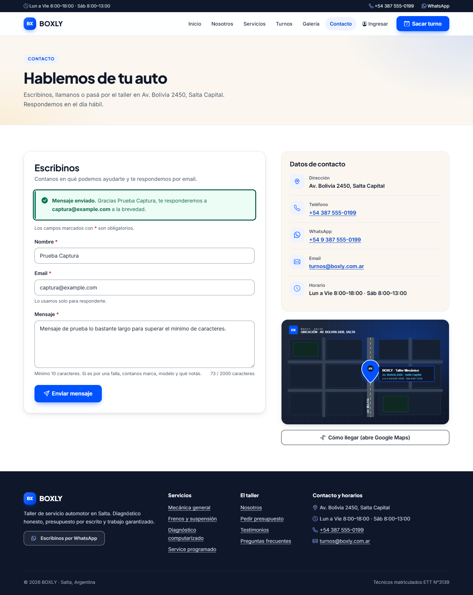
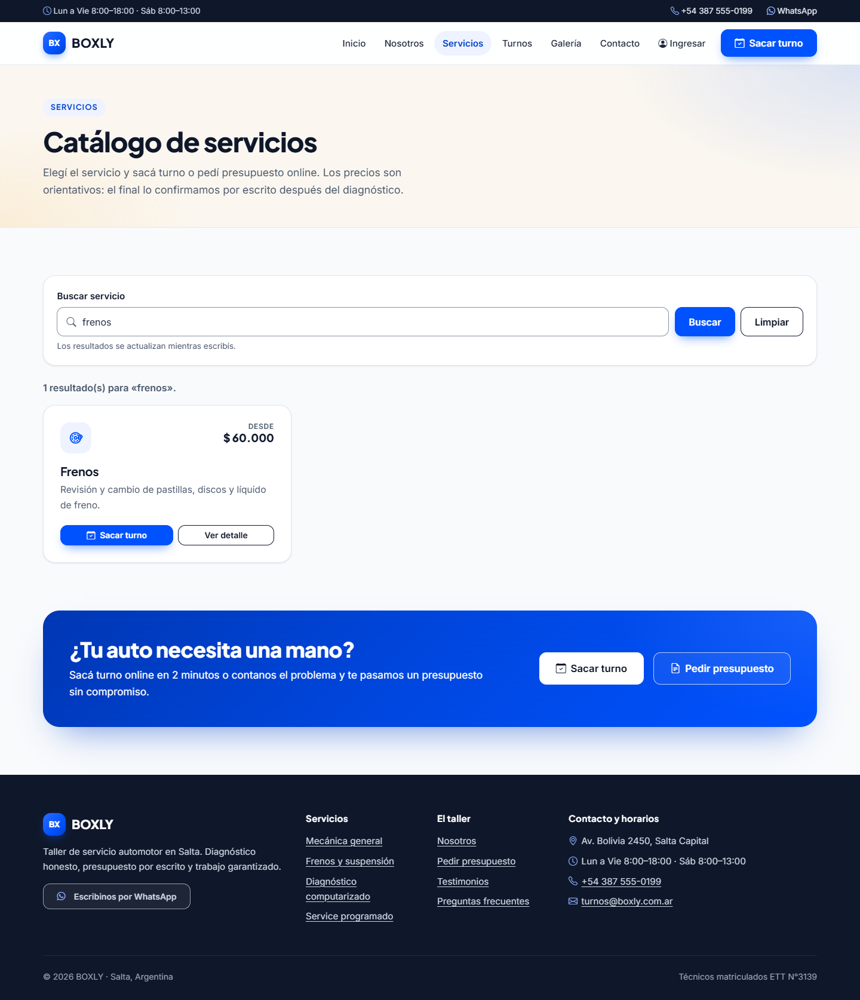
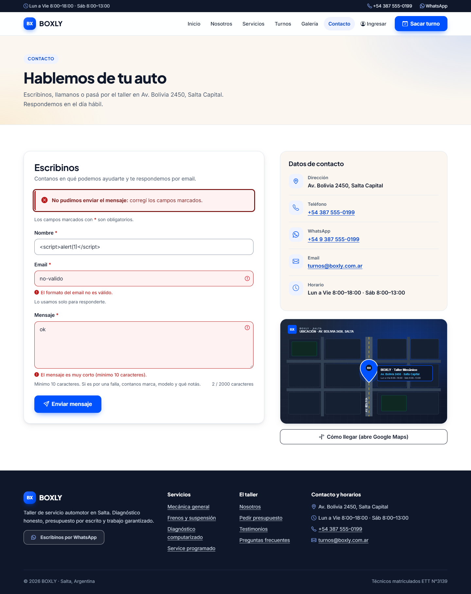

# TP5 — Procesamiento de formularios y seguridad web

Implementación del lado servidor para capturar y procesar los datos que envía el
navegador, con sanitización estricta contra **XSS** (OWASP Top 10) y validación
de entradas. El sitio pasó de ser maquetación estática a PHP con estructura
modular (`includes/header.php`, `includes/footer.php`, `includes/funciones.php`).

## Objetivo

- Procesar formularios con los métodos **POST** (altas / contacto) y **GET**
  (búsqueda / filtros).
- Sanitizar toda entrada de `$_POST` / `$_GET` antes de mostrarla o procesarla.
- Validar en servidor: campos obligatorios, formatos específicos y longitudes.
- Mostrar mensajes claros de éxito/error y **conservar los datos** cargados
  cuando el formulario tiene errores.

## Formularios implementados

| Formulario | Método | Archivo | Validaciones |
|------------|--------|---------|--------------|
| Solicitud de turno | POST | `turnos.php` | Obligatorios, teléfono y patente con regex, año, fecha válida y no pasada, marca/servicios/estado contra catálogos de la base, UTF-8 válido. |
| Contacto | POST | `contacto.php` | Nombre (3–60), email con `filter_var(FILTER_VALIDATE_EMAIL)`, mensaje (10–2000), UTF-8 válido. |
| Presupuesto | POST | `presupuesto.php` | Obligatorios, email válido, teléfono con regex, km numérico, urgencia contra lista blanca (`Normal`/`Urgente`), topes de longitud. |
| Buscador de servicios | GET | `servicios.php?q=` | `filter_input(INPUT_GET, ...)` + `limpiar()`; filtra el catálogo con `mb_stripos()`. |
| Filtro del panel admin | GET | `admin/index.php?estado=` | `filter_input()` + `limpiar()`; filtra turnos por estado. |

## Sanitización y helpers (`includes/funciones.php`)

| Helper | Función |
|--------|---------|
| `limpiar($valor)` | `trim()` + descarta valores no escalares (ej. `nombre[]=x` llega como array → se trata como vacío). |
| `e($valor)` | `htmlspecialchars(..., ENT_QUOTES, 'UTF-8')`: toda salida pasa por acá → previene XSS. |
| `valor()` / `seleccionado()` / `marcado()` | Re-imprimen los datos escapados en el formulario (persistencia ante errores). |
| `claseError()` / `errorCampo()` | Clases `is-invalid` / `invalid-feedback` de Bootstrap por campo. |
| `validarTurno()` | Validación completa del turno (compartida entre sitio público y admin). |

## Retroalimentación y persistencia

- Mensajes generales `alert-success` / `alert-danger` y error específico por
  campo debajo del input.
- Si el envío falla, los valores quedan cargados (escapados) en el formulario.

## Cómo probarlo

```bash
# Servidor embebido de PHP desde la raíz del repo
php -S localhost:8099
```

- POST: abrir `http://localhost:8099/contacto.php` o `presupuesto.php`, enviar
  vacío (errores por campo), con datos inválidos y con datos correctos.
- GET: `http://localhost:8099/servicios.php?q=frenos` filtra el catálogo.
- XSS: enviar `<script>alert(1)</script>` en cualquier campo → se imprime como
  texto escapado (`&lt;script&gt;...`), nunca se ejecuta.

## Pruebas realizadas

- `php -l` sin errores en `contacto.php`, `presupuesto.php`, `includes/funciones.php`,
  `turnos.php` y `servicios.php` (PHP 8.2).
- `curl` con `php -S localhost:8097`:
  - POST a `contacto.php` y `presupuesto.php` con `<script>alert(1)</script>`
    en nombre/email/mensaje → la respuesta contiene `&lt;script&gt;`, sin
    `<script>` ejecutable.
  - GET a `servicios.php?q=<script>alert(1)</script>` → escapado en el input
    y en el mensaje de "sin resultados".
  - Campo enviado como array (`nombre[]=x`) → error de campo obligatorio, sin
    warnings de PHP.
  - Nombre de más de 60 caracteres → "No puede superar los 60 caracteres.";
    byte UTF-8 inválido → "Contiene caracteres no válidos.".
- Regresión: `index.php`, `nosotros.php`, `servicios.php`, `contacto.php`,
  `presupuesto.php`, `faq.php`, `testimonios.php`, `galeria.php`, `login.php`,
  `registro.php` y `turnos.php` responden HTTP 200; `admin/index.php` redirige
  (302) sin sesión como antes.

La auditoría completa requisito por requisito está en
[`CUMPLIMIENTO.md`](CUMPLIMIENTO.md) y las capturas en
[`screenshots/`](screenshots/) (también enlazadas desde el
[README principal](../../README.md)).

## Capturas

Formularios procesados en servidor con sanitización y validación (nuevas capturas del sitio
integrado; las originales de la auditoría siguen en [`screenshots/`](screenshots/)).


*POST a `contacto.php` con email inválido y mensaje corto: errores por campo y valores
persistidos en el formulario.*



*POST correcto: `alert-success` confirmando el envío.*



*`servicios.php?q=frenos`: catálogo filtrado en servidor con `filter_input` + `mb_stripos`.*


*`servicios.php?q=xys`: mensaje de "sin resultados".*


*`servicios.php?q=<script>alert(1)</script>`: el script se imprime escapado en el input y en el
mensaje, nunca se ejecuta.*



*POST a `contacto.php` con `<script>` en el nombre: al volver con errores, el valor se reimprime
escapado con `e()` (`htmlspecialchars`).*
