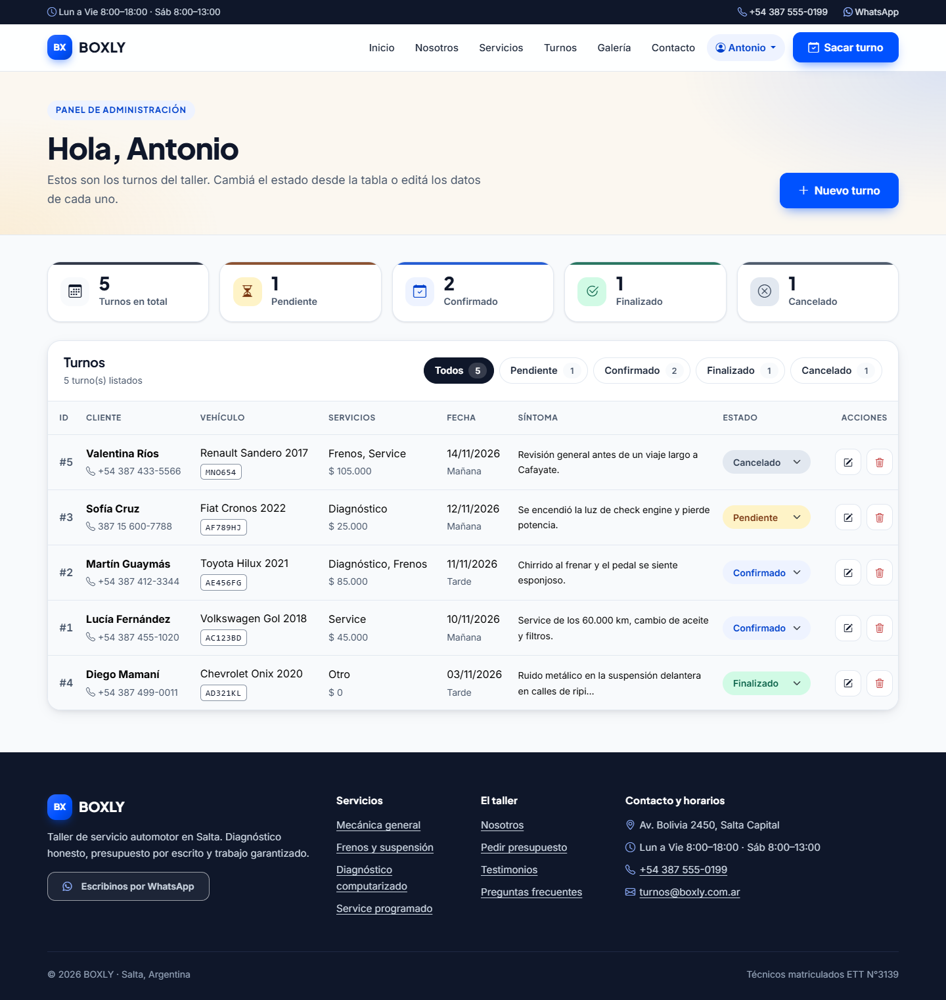
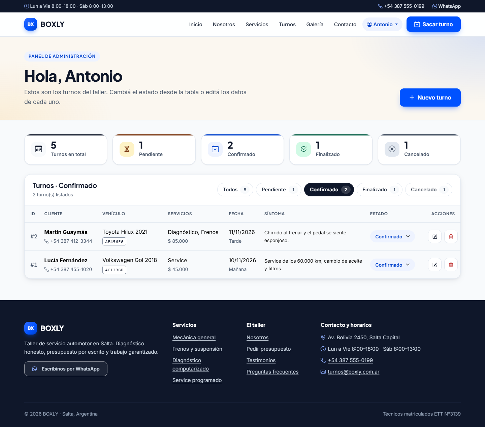
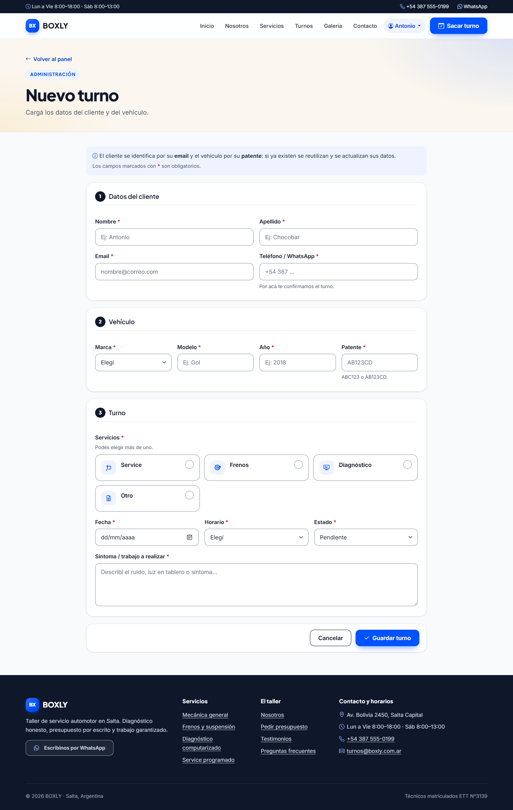
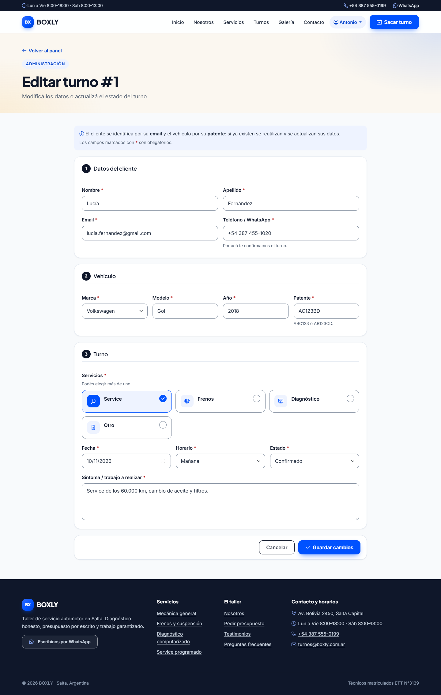
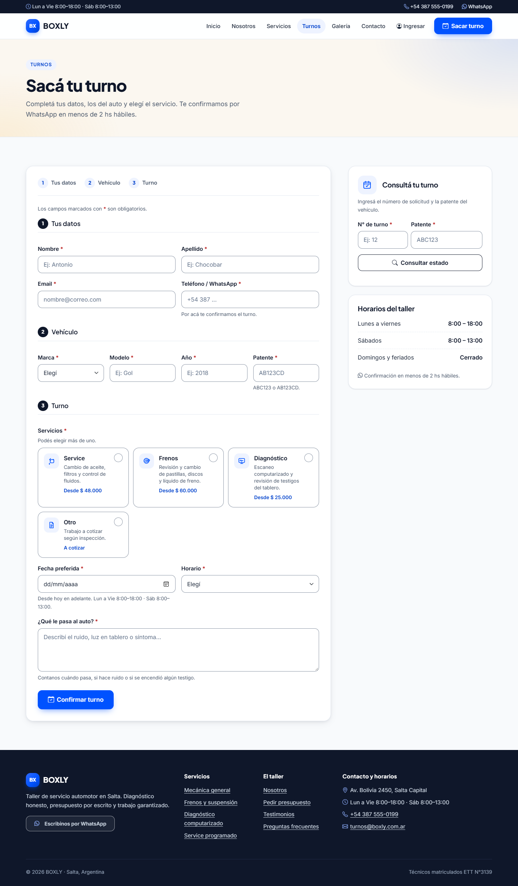
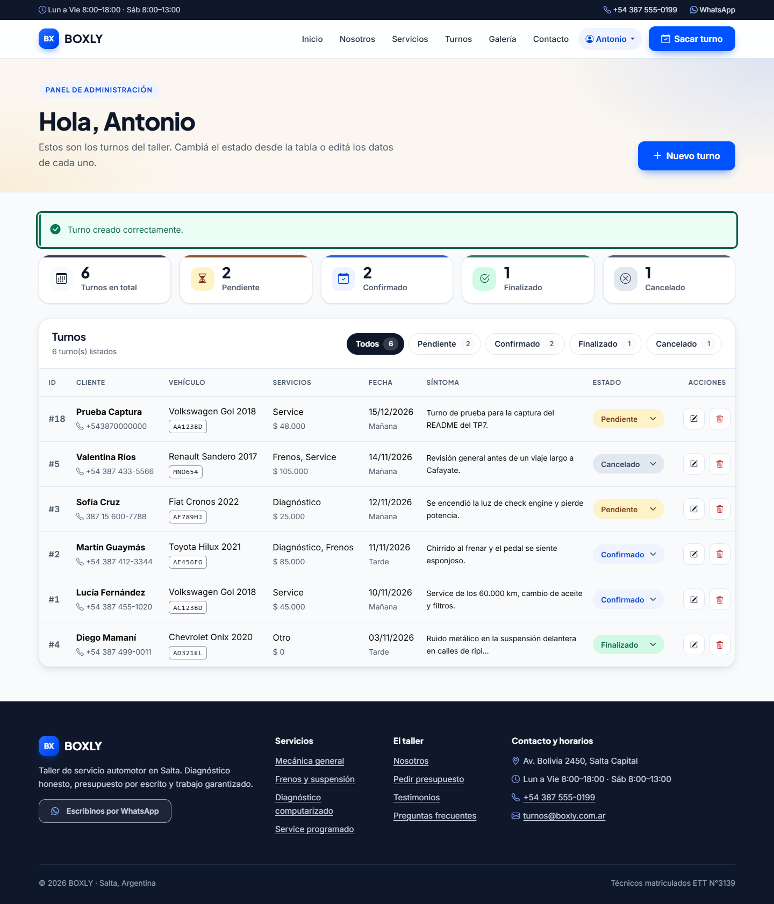
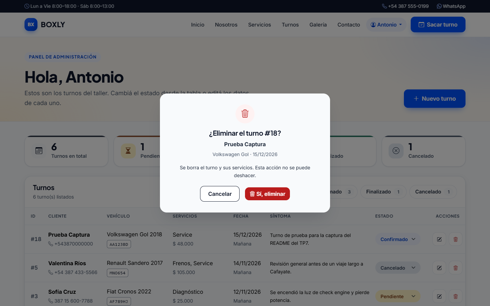
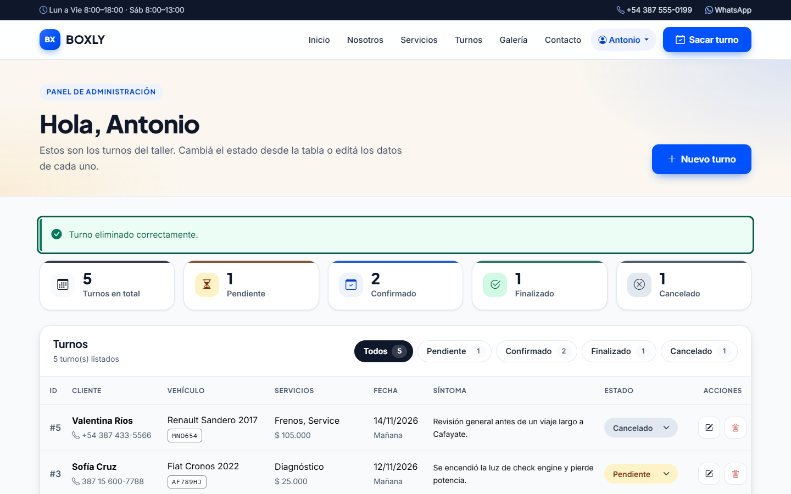

# TP7 — Persistencia y conexión PHP-MySQL segura

## Objetivo

Conectar el sitio BOXLY con MySQL usando PDO, construir un CRUD funcional sobre la tabla de
turnos del TP6 y aplicar las medidas de seguridad obligatorias: consultas preparadas
(anti SQL Injection), sanitización XSS y protección CSRF, todo integrado a la maquetación
del sitio.

## Qué se hizo

### Conexión (`config/conexion.php`)

- Instancia `PDO` con `try/catch (\PDOException)`: si falla, el detalle va a `error_log`
  y el usuario ve un HTTP 500 con mensaje genérico (sin filtrar host ni credenciales).
- Opciones: `ERRMODE_EXCEPTION`, `FETCH_ASSOC` y `EMULATE_PREPARES = false` (prepares
  nativos del servidor).
- DSN con `charset=utf8mb4`; las credenciales reales viven en `config/conexion.local.php`
  (no versionado, está en `.gitignore`) y hay una plantilla
  `config/conexion.local.example.php`.

### Acceso a datos (`includes/turnos_db.php`)

Capa de funciones sobre el esquema normalizado del TP6, todas con sentencias preparadas:

- `catalogos()`: trae marcas, servicios y estados para los `<select>` y las listas blancas.
- `listarTurnos()`: `SELECT` con `INNER JOIN` de turno + cliente + vehículo + marca +
  estado, más los servicios (`GROUP_CONCAT`) y el total desde `turno_servicio`.
- `obtenerTurno()`: lectura de un turno para precargar el formulario de edición.
- `guardarTurno()`: alta o edición en una **transacción** — busca/crea el usuario por
  email, el vehículo por patente, inserta/actualiza el turno y sincroniza sus servicios
  en `turno_servicio` (los que ya estaban conservan su precio congelado). Si algo falla,
  `rollBack()` y se relanza la excepción.
- Desde el sitio público un email o patente existentes se **reutilizan sin pisar sus
  datos**; desde el admin sí se actualizan.

### CRUD en `admin/` (panel del taller)

| Archivo | Operación |
|---------|-----------|
| `admin/index.php` | **Read**: tabla de turnos con JOINs, filtro por estado (lista blanca + prepared), mensajes de estado y formulario de baja con token CSRF. |
| `admin/crear.php` | **Create**: formulario compartido `_formulario.php` + `campos_turno.php`; valida con `validarTurno()` y guarda con `guardarTurno()`. |
| `admin/editar.php` | **Update**: precarga el turno por `id` (entero validado) y actualiza por la misma transacción. |
| `admin/eliminar.php` | **Delete**: solo acepta `POST` con token CSRF válido; `DELETE ... WHERE id = :id` preparado. |

Los errores de base de datos se capturan (`try/catch PDOException`), se registran con
`error_log` y se muestran como alerta controlada en el formulario o como `?status=dberror`.

### Formulario público (`turnos.php` + `includes/campos_turno.php`)

El cliente pide su turno desde el sitio: el formulario lleva token CSRF, se sanitiza y
valida en servidor (`validarTurno()` con listas blancas contra los catálogos), se guarda
con consultas preparadas dentro de un `try/catch` y se muestra un resumen de la
solicitud.

### Seguridad aplicada

| Medida | Implementación |
|--------|----------------|
| SQL Injection | Todas las consultas con `prepare()`/`execute()` y parámetros; `id` con `FILTER_VALIDATE_INT`. |
| XSS | Toda variable impresa pasa por `e()` → `htmlspecialchars(..., ENT_QUOTES, 'UTF-8')`. |
| CSRF | Token de sesión en todos los formularios que modifican datos; la baja solo por POST. |
| Validación | Obligatorios, largos, email, regex de teléfono/patente, fecha válida, UTF-8 y catálogos en servidor. |

## Archivos principales

- `config/conexion.php`, `config/conexion.local.example.php`
- `includes/turnos_db.php`, `includes/campos_turno.php`, `includes/funciones.php`
- `admin/index.php`, `admin/crear.php`, `admin/editar.php`, `admin/eliminar.php`, `admin/_formulario.php`
- `turnos.php`
- Esquema: [`../tp6/schema.sql`](../../tp6/schema.sql) · normalización: [`../tp6/NORMALIZACION.md`](../../tp6/NORMALIZACION.md)

## Cómo correrlo y probarlo

1. Base de datos: ejecutar `tp6/schema.sql` y `tp6/consultas.sql` en MySQL.
2. Credenciales: completar `config/conexion.local.php` (copiar del `.example`).
3. Servidor: `php -S localhost:8099` desde la raíz del proyecto.
4. Probar: `http://localhost:8099/turnos.php` (alta pública) y
   `http://localhost:8099/admin/` (login `admin@boxly.com.ar` / `Boxly2026!` → CRUD completo).

## Pruebas realizadas

- `php -l` sin errores en todos los PHP tocados.
- Scripts del TP6 ejecutados sin errores sobre una copia `boxly_audit` de la base.
- Demo en vivo con `php -S` + curl: login admin → `/admin/` (200, turnos listados),
  `crear.php`/`editar.php` (200), `eliminar.php` rechaza GET y POST sin token CSRF, y
  `turnos.php` rechaza POST sin token / acepta con token (alta y baja de prueba
  verificadas en la base).

## Capturas

CRUD de turnos integrado al sitio: formulario público + panel de administración.

*`admin/`: tabla con `INNER JOIN` (cliente, vehículo, marca, estado, servicios y total).*

*`admin/?estado=2`: solo los turnos en estado *Confirmado* (lista blanca + consulta preparada).*

*`admin/crear.php`: alta de turno con catálogos de la base y validación en servidor.*

*`admin/editar.php?id=1`: formulario precargado con los datos del turno.*

*`turnos.php`: el cliente pide su turno desde el sitio; se guarda con consultas preparadas dentro
de una transacción.*

*Alta desde el panel: el turno "Prueba Captura" queda registrado (`status=created`) con su
usuario, vehículo y servicios en la base.*

*Antes de borrar, el panel pide confirmación en un modal con los datos del turno.*

*Baja por `POST` + token CSRF (nunca por GET): `status=deleted` y el turno desaparece del
listado.*
