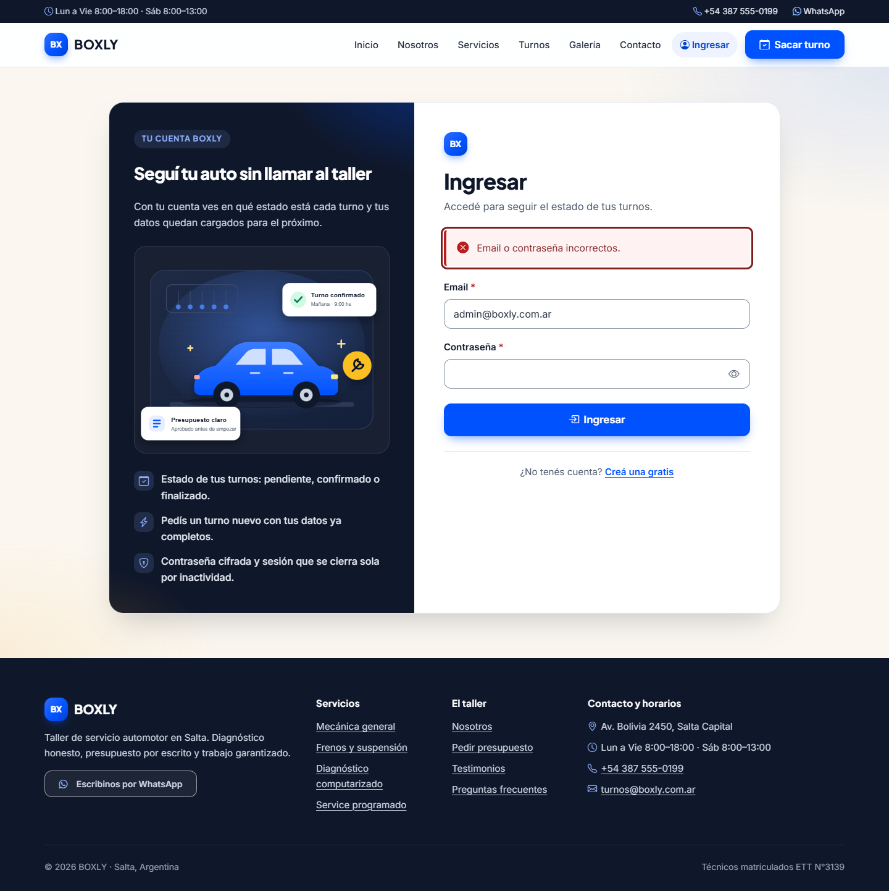
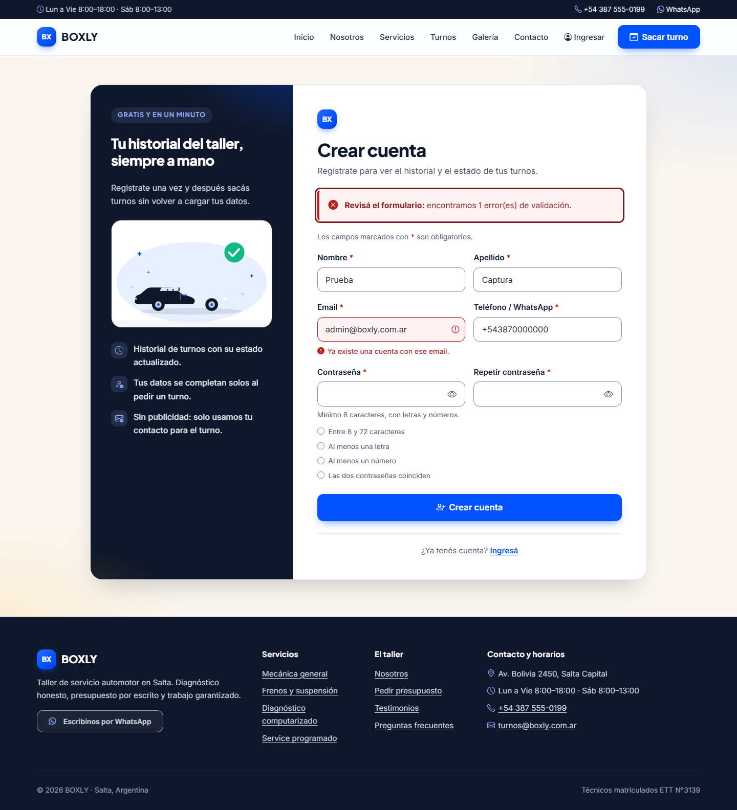
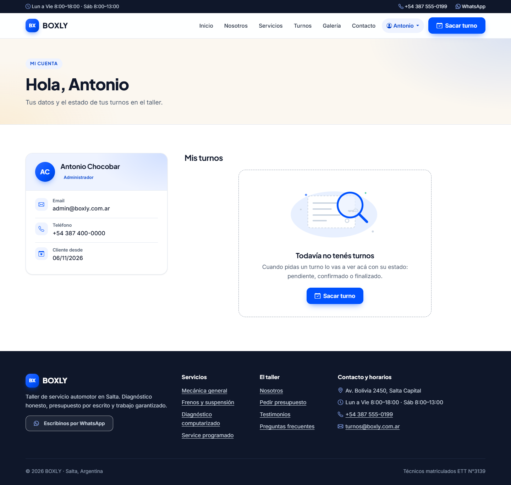
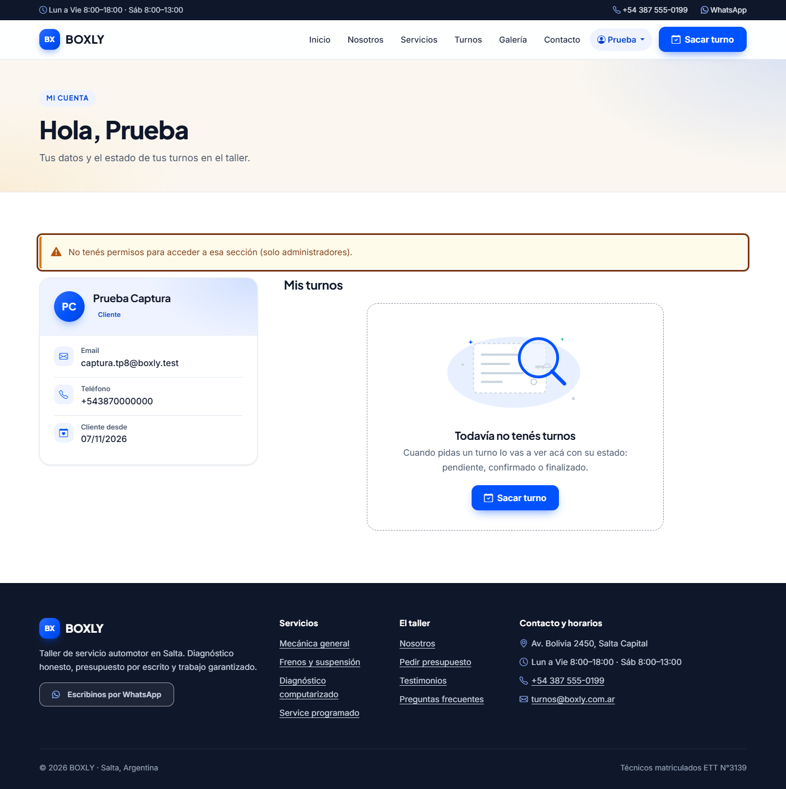

# TP8 — Manejo de estado, sesiones y autenticación

Implementé el módulo completo de cuentas del sitio BOXLY: registro, login, logout,
sesiones seguras con cookies y control de acceso por roles sobre la tabla `usuarios`
del TP6. Todo corre en PHP 8 + MySQL (PDO) sin frameworks.

## Objetivo (según el enunciado)

1. Persistir el estado del usuario en el servidor con `$_SESSION` y cookies de sesión seguras.
2. Módulo de Registro, Login y Logout en PHP conectado a MySQL.
3. Hash de contraseñas con `password_hash()` / `password_verify()` (recomendación OWASP).
4. Protección de rutas y control de acceso por roles (`Administrador` / `Cliente`).

## Lo que implementé

| Archivo | Qué hace |
|---------|----------|
| `includes/sesion.php` | `iniciarSesion()` (una sola vez por request): `session_start()` con `use_strict_mode`, `use_only_cookies`, nombre `BOXLYSESSID` y cookie `HttpOnly` + `SameSite=Lax` + `Secure` bajo HTTPS. `usuarioActual()` devuelve los datos del usuario logueado o `null`. `abrirSesion()` hace `session_regenerate_id(true)` (anti Session Fixation), rota el CSRF y guarda `$_SESSION['usuario_id']`, `['usuario_nombre']` y `['rol']`. `cerrarSesion()` vacía `$_SESSION`, borra la cookie con `session_get_cookie_params()` y llama a `session_destroy()`. Incluye además expiración por 30 minutos de inactividad. |
| `includes/usuarios_db.php` | Acceso a datos con PDO y consultas preparadas: `buscarUsuarioPorEmail()`, `obtenerUsuario()`, `emailRegistrado()`, `registrarUsuario()` (INSERT con `password_hash(..., PASSWORD_BCRYPT)`), `autenticar()` (`password_verify()` + hash ficticio para no revelar emails existentes + rehash si hace falta) y `validarRegistro()` (sanitización y validación completa del formulario). |
| `includes/auth_guard.php` | Guardián reutilizable: sin `$_SESSION['usuario_id']` redirige a `login.php?error=acceso_denegado`; con `$rolesPermitidos` definido antes del `require` restringe por rol (si no coincide → `mi-cuenta.php?error=sin_permiso`). |
| `registro.php` | Formulario de alta de cliente: sanitiza y valida en servidor, verifica email único (consulta previa + `UNIQUE` de la base con catch de `23000`), hashea la contraseña y redirige al login. CSRF en el formulario. |
| `login.php` | Valida credenciales con `password_verify()`; si son correctas abre la sesión y redirige según rol (admin → `admin/index.php`, cliente → `mi-cuenta.php`). Muestra avisos para `error=acceso_denegado`, `ok=registro` y `ok=logout`, y un error genérico que no revela si el email existe. |
| `logout.php` | Cierre de sesión **solo por POST con token CSRF** (un link externo no puede desloguear): llama a `cerrarSesion()` y vuelve al login. |
| `mi-cuenta.php` | Vista protegida para cualquier usuario logueado: muestra sus datos, su rol y sus turnos (`listarTurnos()` filtrado por `usuario_id`). |

## Vistas protegidas

- `mi-cuenta.php` — cualquier usuario autenticado.
- `admin/index.php`, `admin/crear.php`, `admin/editar.php`, `admin/eliminar.php` — solo rol
  *Administrador* (`$rolesPermitidos = ['Administrador']` antes del `require` del guard).
  Un cliente que intenta entrar es redirigido a `mi-cuenta.php?error=sin_permiso`.
- Con sesión iniciada, el menú muestra el nombre del usuario, el panel (si es admin) y
  la opción de cerrar sesión; `turnos.php` precarga los datos de la cuenta.

## Base de datos

La tabla `usuarios` ya existía del TP6 (`tp6/schema.sql`): `id`, `nombre`, `apellido`,
`email` UNIQUE, `password_hash` VARCHAR(255), `rol_id` → `roles` (*Administrador* /
*Cliente*) y `created_at`. Es el equivalente normalizado de lo que pide el enunciado
(`password` → `password_hash`, `rol` → catálogo `roles`). El admin de prueba es
`admin@boxly.com.ar` / `Boxly2026!`.

## Cómo correrlo y probarlo

```bash
# 1. Base de datos (una sola vez): tp6/schema.sql y luego tp6/consultas.sql
# 2. Credenciales en config/conexion.local.php
# 3. Servidor embebido de PHP
php -S localhost:8099
```

Pruebas manuales:

1. Entrar a `http://localhost:8099/admin/` sin sesión → redirige a
   `login.php?error=acceso_denegado` con el aviso correspondiente.
2. Registrarse en `registro.php` (email nuevo, contraseña de 8+ caracteres con letras
   y números) → vuelve al login con "Cuenta creada correctamente".
3. Iniciar sesión con `admin@boxly.com.ar` / `Boxly2026!` → cae en `admin/index.php`.
4. Iniciar sesión con un cliente → cae en `mi-cuenta.php`; al pedir `/admin/` es
   redirigido con aviso de falta de permisos.
5. Cerrar sesión desde el menú → la cookie `BOXLYSESSID` se borra y las vistas
   protegidas vuelven a pedir login.

## Decisiones tomadas

- **Roles por catálogo:** en vez de un string `rol` en `usuarios`, usé la FK `rol_id`
  → `roles` que ya define el TP6 (*Administrador* / *Cliente*). La sesión guarda el
  nombre del rol y el guard compara contra esa lista blanca.
- **Cookie de sesión:** `HttpOnly` (no accesible desde JS), `SameSite=Lax` (mitiga CSRF
  en navegaciones cruzadas), `Secure` solo bajo HTTPS (en `php -S` local no aplica) y
  `use_strict_mode` para rechazar IDs que el servidor no generó.
- **Anti Session Fixation:** `session_regenerate_id(true)` en cada login y rotación del
  token CSRF; además la sesión expira tras 30 minutos sin actividad.
- **Logout solo por POST + CSRF:** evita que un `` o link externo cierre la sesión
  del usuario (logout forzado).
- **Errores de autenticación genéricos:** "Email o contraseña incorrectos" tanto si el
  email no existe como si la contraseña falla; el hash ficticio iguala los tiempos de
  respuesta para no revelar qué cuentas están registradas.
- **Validación estricta en el registro:** lista blanca de caracteres en nombre/apellido
  (solo letras, espacios, apóstrofo, punto y guion), `filter_var` para el email, tope de
  72 bytes en la contraseña (límite real de bcrypt) y verificación de UTF-8 válido.

## Pruebas realizadas

Auditoría completa con `php -l` (sin errores en los 7 archivos) y pruebas funcionales
con `php -S localhost:8095` + `curl` con cookie jar. Evidencia detallada en
[`CUMPLIMIENTO.md`](CUMPLIMIENTO.md):

- `/admin/` y `/mi-cuenta.php` sin sesión → 302 a `login.php?error=acceso_denegado`.
- Login admin → 302 a `admin/index.php`, `BOXLYSESSID` con `HttpOnly; SameSite=Lax` y
  el ID de sesión cambia respecto al anónimo (regeneración verificada).
- Registro de `auditoria<timestamp>@boxly.test` → 302 a `login.php?ok=registro`; su
  login lleva a `mi-cuenta.php` y `/admin/` le responde 302 a
  `mi-cuenta.php?error=sin_permiso`.
- Logout → `Set-Cookie: BOXLYSESSID=deleted` y ambas vistas protegidas vuelven a pedir
  login.
- Email duplicado → "Ya existe una cuenta con ese email."; password incorrecto →
  mensaje genérico.

## Capturas

Módulo de cuentas: login, registro, sesiones y control de acceso por roles.


*`login.php`: validación con `password_verify()` y sesión regenerada (`session_regenerate_id`).*


*Entrar a `/admin/` sin sesión redirige a `login.php?error=acceso_denegado` con el aviso
correspondiente.*



*Error genérico "Email o contraseña incorrectos": no revela si el email existe.*


*`registro.php`: alta de cliente con sanitización, email único y `password_hash` bcrypt.*



*Registrarse con un email existente muestra "Ya existe una cuenta con ese email."*



*`mi-cuenta.php`: vista protegida con los datos del usuario y sus turnos.*



*Un usuario con rol *Cliente* que pide `/admin/` es redirigido a
`mi-cuenta.php?error=sin_permiso`.*


*Cierre de sesión por `POST` + CSRF desde el menú: la cookie `BOXLYSESSID` se borra y las vistas
protegidas vuelven a pedir login.*
