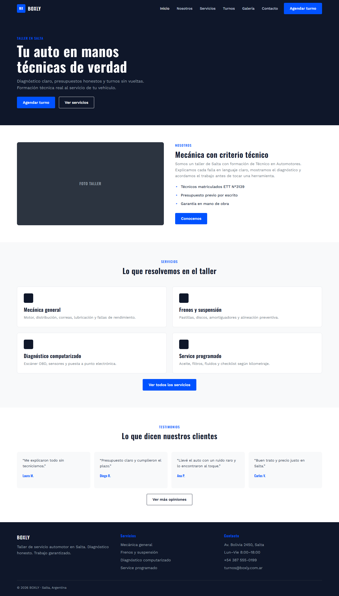
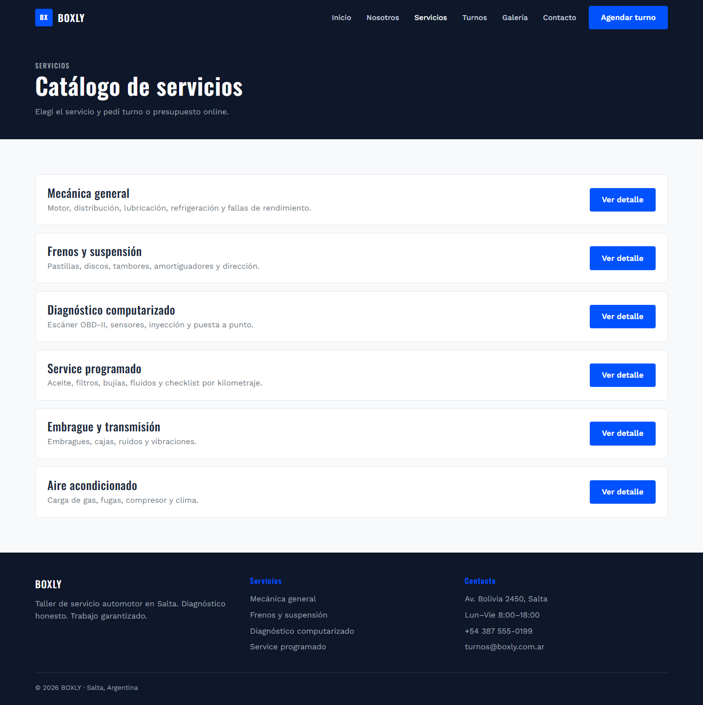
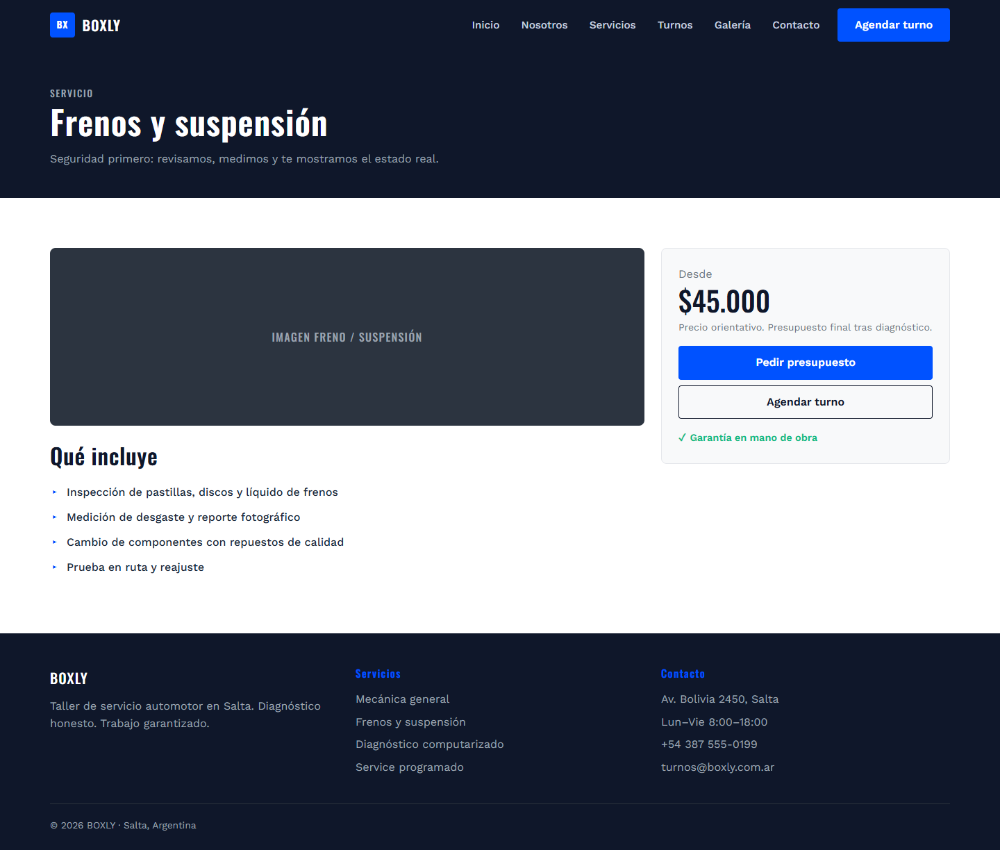
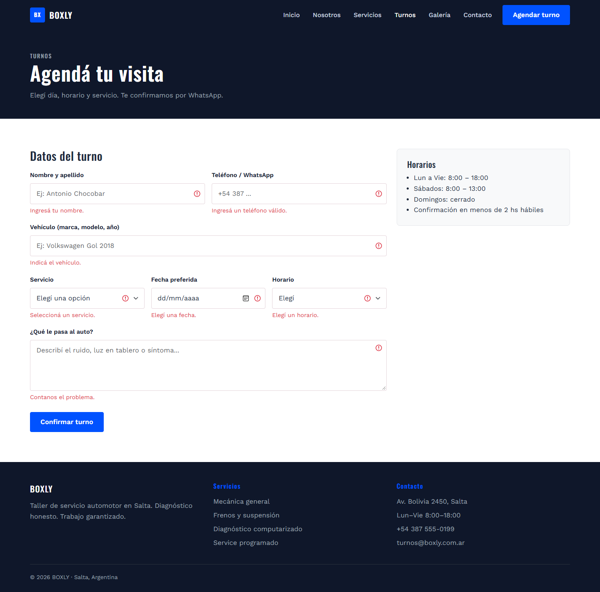
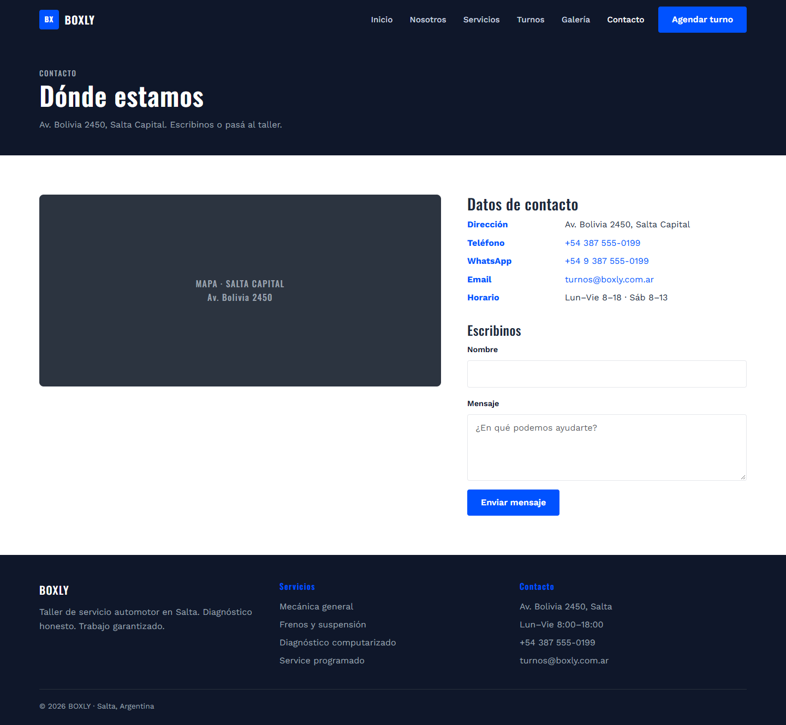
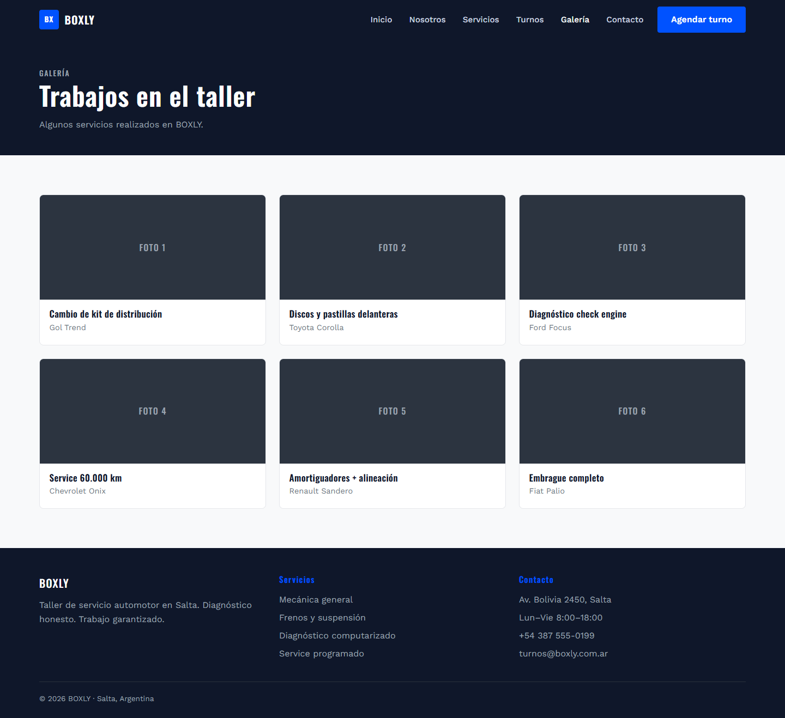
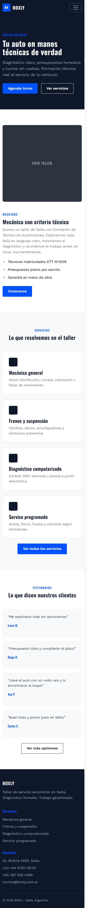

# TP4 — Maquetación estática HTML + Bootstrap

Primera versión del sitio **BOXLY** completamente estática: las 10 vistas
diseñadas en los mockups del TP3 maquetadas en HTML5 + Bootstrap 5, con CSS
propio y un poco de JavaScript. Es la base visual que después se convirtió en el
sitio PHP del TP5 en adelante.

## Objetivo

- Maquetar todas las vistas del sitio en HTML semántico y responsive.
- Usar **Bootstrap 5** para la grilla, componentes y utilidades.
- Aplicar la identidad BOXLY (paleta y tipografías de los mockups del TP3).
- Dejar los formularios con validación del lado del cliente.
- Verificar accesibilidad con una auditoría **Lighthouse**.

## Vistas (10)

| Archivo | Contenido |
|---------|-----------|
| `index.html` | Home: hero, presentación, servicios destacados y testimonios |
| `nosotros.html` | Historia y datos del taller |
| `servicios.html` | Catálogo de servicios |
| `servicio-detalle.html` | Detalle de un servicio (frenos y suspensión) |
| `turnos.html` | Formulario de agendar turno |
| `presupuesto.html` | Formulario de solicitud de presupuesto |
| `testimonios.html` | Reseñas de clientes |
| `galeria.html` | Trabajos realizados (imágenes SVG propias en `img/galeria/`) |
| `contacto.html` | Datos de contacto, mapa y formulario |
| `faq.html` | Preguntas frecuentes |

## Estructura

```
tp4-html/
├── *.html                  ← las 10 vistas (todas enlazadas entre sí)
├── css/
│   └── styles.css          ← tema BOXLY: paleta, tipografías, componentes
├── js/
│   └── main.js             ← nav activo por página + validación de formularios
├── img/
│   ├── placeholder.svg     ← placeholder genérico accesible
│   └── galeria/            ← ilustraciones SVG de trabajos
└── auditoria-lighthouse.md ← auditoría de accesibilidad y checklist
```

## Decisiones técnicas

- **Bootstrap 5.3 por CDN** (CSS + JS bundle) + `css/styles.css` con variables
  CSS (`--bx-ink`, `--bx-accent`, etc.) que implementan la paleta de los mockups.
- **Tipografías:** Oswald para títulos y Work Sans para cuerpo (Google Fonts).
- **`js/main.js`:** marca el enlace de navegación activo según la página actual
  (`aria-current="page"`) y valida los formularios con `checkValidity()` +
  clases `needs-validation` / `was-validated` de Bootstrap.
- **Formularios:** `turnos.html`, `presupuesto.html` y `contacto.html` usan
  `data-validate` + `novalidate` (la validación la hace el JS, no el navegador).
- **Accesibilidad:** `lang="es"`, link "Saltar al contenido", landmarks
  (`header`/`nav`/`main`/`footer`), `<label>` en todos los inputs, `alt` /
  `role="img"` + `aria-label` en imágenes, un solo `h1` por página y menú
  colapsable con `aria-label`.
- **Imágenes:** ilustraciones SVG propias (`img/galeria/trabajo-1.svg`,
  `placeholder.svg`), sin dependencias externas.

## Cómo correrlo

No necesita backend ni base de datos. Cualquier servidor estático sirve:

```bash
# Opción 1: Live Server de VS Code sobre esta carpeta
# Opción 2: servidor embebido de PHP
php -S localhost:8099 -t entregas/tp4-html
# Opción 3: npx serve entregas/tp4-html
```

Abrir `index.html` y navegar por el menú. La versión publicada está en GitHub
Pages: https://antony27c.github.io/Programacion-Web/entregas/tp4-html/

## Auditoría Lighthouse

En [`auditoria-lighthouse.md`](auditoria-lighthouse.md) está documentado cómo
repetir la auditoría de accesibilidad (Chrome DevTools → Lighthouse), las
correcciones aplicadas (contraste, labels, landmarks, skip link) y el
checklist por vista. Los scores se completan al correr Lighthouse en cada
máquina.

## Formato

```bash
npm install
npm run format        # Prettier sobre html/css/js/md del repo
npm run format:check
```

## Capturas

Las 10 vistas maquetadas en HTML5 + Bootstrap 5 (sitio estático, sin backend).



*Home: hero, presentación, servicios destacados y testimonios.*



*Catálogo de servicios con precios base.*



*Detalle de servicio (frenos y suspensión) con especificaciones.*



*Formulario de agendar turno enviado vacío: `js/main.js` marca los campos inválidos con las
clases `was-validated` / `needs-validation` de Bootstrap (validación del lado del cliente).*



*Datos de contacto, mapa y formulario de mensaje.*



*Trabajos realizados con ilustraciones SVG propias.*



*La misma home a 390 px de ancho: grilla y menú colapsable de Bootstrap en mobile.*
