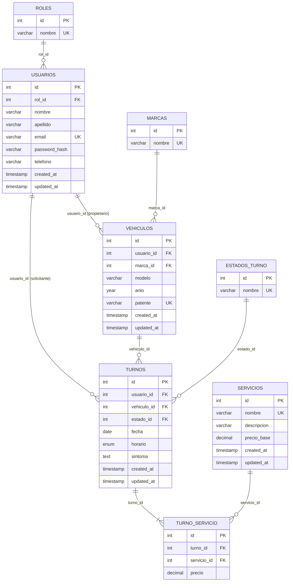

# TP6 — Normalización del esquema de BOXLY

Proyecto integrador: **BOXLY**, sistema web de turnos para un taller mecánico de Salta.
Un cliente pide un turno para su vehículo, elige uno o más servicios y el taller lo gestiona
(pendiente → confirmado → finalizado / cancelado) desde el panel de administración.

Archivos de esta entrega:

| Archivo | Contenido |
|---------|-----------|
| [`NORMALIZACION.md`](NORMALIZACION.md) | Parte 1: tabla sin normalizar, 1FN, 2FN, 3FN y tablas resultantes |
| [`schema.sql`](schema.sql) | Parte 2: DDL — base `boxly`, 8 tablas, PK, FK, auditoría e índices |
| [`consultas.sql`](consultas.sql) | Parte 3: DML — `INSERT`, `SELECT` (WHERE, ORDER BY, INNER JOIN), `UPDATE` y `DELETE` |

---

## 1. Tabla sin normalizar

Así se vería una "planilla de turnos" cargada en una sola tabla (similar a la primera
versión del TP7, donde todo vivía en `turnos`):

| turno | fecha | horario | cliente | email | telefono | rol | vehiculo | servicios | precios | estado | sintoma |
|-------|-------|---------|---------|-------|----------|-----|----------|-----------|---------|--------|---------|
| 2 | 2026-11-11 | Tarde | Martín Guaymás | martin.guaymas@gmail.com | +54 387 412-3344 | Cliente | Toyota Hilux 2021 AE456FG | **Frenos, Diagnóstico** | **60000, 25000** | Pendiente | Chirrido al frenar… |
| 7 | 2026-11-25 | Mañana | Martín Guaymás | martin.guaymas@gmail.com | +54 387 412-3344 | Cliente | Toyota Hilux 2021 AE456FG | Service | 45000 | Pendiente | Service de los 50.000 km |
| 3 | 2026-11-12 | Mañana | Sofía Cruz | sofia.cruz@hotmail.com | 387 15 600-7788 | Cliente | Fiat Cronos 2022 AF789HJ | Diagnóstico | 25000 | Pendiente | Luz de check engine… |

Problemas detectados:

- **Campos multivalorados:** `servicios` y `precios` guardan listas separadas por coma.
- **Campos compuestos (no atómicos):** `cliente` mezcla nombre y apellido; `vehiculo` mezcla
  marca, modelo, año y patente.
- **Redundancia:** los datos de Martín y de su Hilux se repiten en cada turno que pide.
- **Anomalías:**
  - *Actualización:* si Martín cambia de teléfono hay que modificar todas sus filas.
  - *Inserción:* no se puede registrar un servicio nuevo (con su precio) sin inventar un turno.
  - *Borrado:* al eliminar el único turno de Sofía se pierden sus datos y los de su vehículo.

---

## 2. Proceso de normalización

### 2.1 Primera Forma Normal (1FN) — valores atómicos

Se separan los campos compuestos en columnas atómicas y se elimina el grupo repetitivo
`servicios/precios`: **una fila por cada servicio de cada turno**.
La clave pasa a ser compuesta: **PK = (turno, servicio)**.

| turno (PK) | servicio (PK) | precio | fecha | horario | nombre | apellido | email | telefono | rol | marca | modelo | anio | patente | estado | sintoma |
|-------|----------|--------|-------|---------|--------|----------|-------|----------|-----|-------|--------|------|---------|--------|---------|
| 2 | Frenos | 60000 | 2026-11-11 | Tarde | Martín | Guaymás | martin.guaymas@gmail.com | +54 387 412-3344 | Cliente | Toyota | Hilux | 2021 | AE456FG | Pendiente | Chirrido al frenar… |
| 2 | Diagnóstico | 25000 | 2026-11-11 | Tarde | Martín | Guaymás | martin.guaymas@gmail.com | +54 387 412-3344 | Cliente | Toyota | Hilux | 2021 | AE456FG | Pendiente | Chirrido al frenar… |
| 7 | Service | 45000 | 2026-11-25 | Mañana | Martín | Guaymás | martin.guaymas@gmail.com | +54 387 412-3344 | Cliente | Toyota | Hilux | 2021 | AE456FG | Pendiente | Service de los 50.000 km |
| 3 | Diagnóstico | 25000 | 2026-11-12 | Mañana | Sofía | Cruz | sofia.cruz@hotmail.com | 387 15 600-7788 | Cliente | Fiat | Cronos | 2022 | AF789HJ | Pendiente | Luz de check engine… |

Ahora cada celda tiene un solo valor, pero la redundancia empeoró: el turno 2 repite todos
sus datos en dos filas.

### 2.2 Segunda Forma Normal (2FN) — sin dependencias parciales

Dependencias funcionales sobre la clave compuesta `(turno, servicio)`:

| Dependencia | Tipo |
|-------------|------|
| `turno → fecha, horario, sintoma, estado, nombre, apellido, email, telefono, rol, marca, modelo, anio, patente` | **Parcial** (depende solo de una parte de la clave) |
| `servicio → precio_base` | **Parcial** |
| `(turno, servicio) → precio` (precio cobrado en ese turno) | Completa |

Se descompone en tres tablas, cada una con sus atributos dependiendo de la clave completa:

- **TURNOS** (`turno_id` (PK), fecha, horario, sintoma, estado, nombre, apellido, email,
  telefono, rol, marca, modelo, anio, patente)
- **SERVICIOS** (`servicio_id` (PK), nombre, precio_base)
- **TURNO_SERVICIO** (`turno_id` (PK, FK), `servicio_id` (PK, FK), precio)

> `turno_servicio.precio` **no es redundante** con `servicios.precio_base`: guarda el precio
> pactado en ese turno. Si mañana sube el precio base, los turnos ya presupuestados no cambian.

### 2.3 Tercera Forma Normal (3FN) — sin dependencias transitivas

En `TURNOS` todavía hay atributos no clave que dependen de **otros atributos no clave**:

| Dependencia transitiva | Se extrae a |
|------------------------|-------------|
| `turno_id → email → nombre, apellido, telefono, rol` | **USUARIOS** (el cliente se identifica por su email) |
| `email → rol` (y el rol es un dominio fijo) | **ROLES** |
| `turno_id → patente → marca, modelo, anio` | **VEHICULOS** (el vehículo se identifica por su patente) |
| `patente → marca` (catálogo de marcas) | **MARCAS** |
| `turno_id → estado` (catálogo de estados) | **ESTADOS_TURNO** |

Catálogos como marcas, estados y roles se llevan a tablas propias para evitar valores
mal escritos ("Toyota" / "toyota" / "Toyta"), poder agregar opciones sin modificar la
estructura y referenciarlos mediante FK.

Resultado en `TURNOS`: solo quedan los datos propios del turno (`fecha`, `horario`,
`sintoma`) y las FK `usuario_id`, `vehiculo_id`, `estado_id`.

#### Decisiones de diseño

- **Claves sustitutas:** todas las tablas usan `id INT UNSIGNED AUTO_INCREMENT PRIMARY KEY`.
  Las claves naturales (`email`, `patente`, nombres de catálogo y el par
  `turno_id + servicio_id`) se conservan como `UNIQUE`.
- **`turnos.usuario_id` y `vehiculos.usuario_id` no son redundantes:** el primero es quien
  *solicita* el turno y el segundo es el *propietario* del vehículo. No siempre coinciden
  (p. ej. alguien lleva el auto de un familiar), por lo que el solicitante no se puede
  derivar del vehículo.
- **`horario` como `ENUM('Mañana','Tarde')`:** es un dominio fijo de dos valores sin
  atributos propios; una tabla aparte no aporta información.
- **`password_hash` admite `NULL`:** los clientes que piden turno desde la web quedan
  registrados sin acceso hasta crear su contraseña. El administrador sí tiene hash (bcrypt).
- **Integridad referencial:** las FK usan `ON DELETE RESTRICT` (no se puede borrar un
  cliente con turnos, ni un servicio usado) salvo `turno_servicio.turno_id`, que usa
  `ON DELETE CASCADE`: al eliminar un turno se eliminan sus renglones de detalle.

---

## 3. Tablas resultantes

| Tabla | PK | FK | Otros campos | Restricciones / índices |
|-------|----|----|--------------|-------------------------|
| `roles` | `id` | — | `nombre` | `UNIQUE(nombre)` |
| `estados_turno` | `id` | — | `nombre` | `UNIQUE(nombre)` |
| `marcas` | `id` | — | `nombre` | `UNIQUE(nombre)` |
| `servicios` | `id` | — | `nombre`, `descripcion`, `precio_base`, `created_at`, `updated_at` | `UNIQUE(nombre)`, `CHECK(precio_base >= 0)` |
| `usuarios` | `id` | `rol_id → roles.id` | `nombre`, `apellido`, `email`, `password_hash`, `telefono`, `created_at`, `updated_at` | `UNIQUE(email)`, `idx_usuarios_apellido_nombre` |
| `vehiculos` | `id` | `usuario_id → usuarios.id`, `marca_id → marcas.id` | `modelo`, `anio`, `patente`, `created_at`, `updated_at` | `UNIQUE(patente)` |
| `turnos` | `id` | `usuario_id → usuarios.id`, `vehiculo_id → vehiculos.id`, `estado_id → estados_turno.id` | `fecha`, `horario`, `sintoma`, `created_at`, `updated_at` | `idx_turnos_fecha`, `idx_turnos_estado_fecha` |
| `turno_servicio` | `id` | `turno_id → turnos.id`, `servicio_id → servicios.id` | `precio` | `UNIQUE(turno_id, servicio_id)`, `CHECK(precio >= 0)` |

### Diagrama entidad-relación

### Cardinalidades

- Un **rol** tiene muchos usuarios; cada usuario tiene un rol (1:N).
- Un **usuario** puede tener muchos vehículos y pedir muchos turnos (1:N).
- Una **marca** agrupa muchos vehículos (1:N).
- Un **vehículo** puede tener muchos turnos a lo largo del tiempo (1:N).
- Un **estado** se asigna a muchos turnos (1:N).
- **Turnos ↔ servicios** es **N:M**: un turno incluye uno o más servicios y un servicio
  aparece en muchos turnos → se resuelve con la tabla de detalle `turno_servicio`.

---

## 4. Cómo probarlo

1. Abrir `schema.sql` en phpMyAdmin / MySQL Workbench y ejecutarlo completo.
2. Abrir `consultas.sql` y ejecutarlo completo (o sentencia por sentencia para ver cada resultado).
3. El sitio PHP (`turnos.php` y `admin/`) ya trabaja sobre este esquema.
